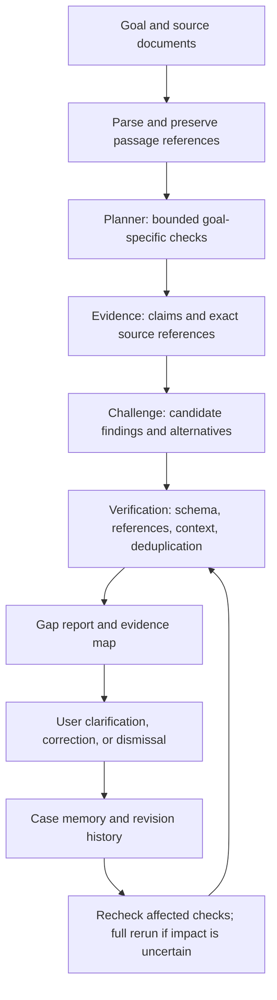

# ContextGuard — Validated Idea and Technical Plan

> **Implementation update ? 23 October 2026:** A new local application now exists in this workspace. See `README.md`, `devpost/checklist.md`, and `evaluation/results.md` for startup, verified behavior, and remaining live-AI checks. The original planning snapshot is preserved below; concept-stage status statements are historical. The evidence map uses native HTML/CSS rather than React Flow.

Research date: 23 October 2026. Status: proposed product; no application implementation or live model calls have been verified. This document consolidates the agreed idea, enhancements, open-source shortlist, and AI/API requirements. It supplements ContextGuard_Complete_Project_Context.md; it does not replace the required Devpost Skill Pack artifacts.

User-perspective review: 23 October 2026. The recommendations below are a desk review of the proposed experience, supported by published usability principles; they are not interviews, observed user behavior, or validation of demand. The refined scope and user journey in this document take precedence over broader feature suggestions in the original blueprint.

## 1. The idea and what the user gets

**ContextGuard takes a decision goal and source documents, checks whether the available evidence supports proceeding, and shows what must be clarified first.**

First audience: small software/project teams preparing to begin development. First goal: "Are we ready to start development?"

The initial user hypothesis is a project lead or freelancer preparing a kickoff or the next sprint from a client brief, requirements, and meeting notes. Their immediate job is: **"Before I commit the team to this work, help me identify the decisions I need to clarify and prepare the questions for our kickoff."** Students and procurement teams remain future audiences rather than additional MVP templates.

Refined product promise: **"Find the unresolved decisions in your project documents, see the evidence, and prepare what to clarify before kickoff."** The review concerns evidence in the supplied documents; it cannot certify actual staffing, technical feasibility, budget sufficiency, or project readiness without relevant inputs and checks.

The user supplies a proposal, requirements, meeting notes, and task list through PDF/DOCX upload or pasted text. The app produces a Context Gap Report with:

- Source-supported statements and the checks performed, with user assertions identified separately.
- Potential conflicts, missing information, unsupported assumptions, and unresolved dependencies.
- Exact source passages with document/page or paragraph references.
- Blocking, important, or informational priority, with an explanation.
- Targeted clarification questions and recommended actions.
- An updated report after the user clarifies, corrects, resolves, or dismisses an issue.
- A short, copyable kickoff brief containing open decisions, source references, questions, and any user-assigned owners.

Example: a proposal says "release November 15" while meeting notes say "November 20." Show both quotes, ask whether they describe the same milestone, and let the user identify the authoritative date. A second finding may state "approval evidence was not found in the supplied sources," rather than claiming approval never happened.

The benefit is reduced manual comparison and a visible list of uncertainties before committing work. The user makes the final decision.

## 2. Validation verdict and boundaries

**Recommendation: proceed with a focused proof of concept.** This is a product/engineering assessment, not validated market demand or measured model accuracy.

| Question | Assessment | Evidence still needed |
|---|---|---|
| Is the problem concrete? | Yes: conflicting plans and undocumented decisions have a clear review workflow. | Interviews or observed use by real project leads. |
| Can a small app demonstrate it? | Plausible with four short documents and a bounded checklist. | Run the actual complete journey. |
| Does adding agents help? | Roles make planning, extraction, and challenge inspectable. | Compare against one well-prompted model on identical inputs. |
| Does memory help? | Yes when it preserves explicit corrections and source choices. | Test persistence, revocation, and changed-document handling. |
| Does a graph help? | Useful for tracing one issue to its evidence and dependencies. | Check users can understand it faster than the findings list alone. |
| Is the concept unique? | Not established. Citations, reports, and mind maps already exist elsewhere. | Fair competitor/baseline comparison; no exclusivity claim. |

The biggest adoption risks are preparation effort, generic alerts, false blockers, and a report that creates more reading without helping the next conversation. Address them with a sample case, optional source metadata, editable review criteria, a small first set of consequential findings, and a copyable brief. Repeat use is expected at a changed-document or planning milestone; daily engagement is not a goal by itself.

Google's source-grounded notebook product (the former NotebookLM help URL now redirects to Gemini Notebook help) already documents source-based chat, reports, mind maps, and infographics. Therefore "documents + AI + graph" is insufficient differentiation. Our proposed distinction is goal-specific checks, carefully qualified findings, inspectable evidence, and a correction/recheck loop with measured false alarms. This is our positioning hypothesis, not proof competitors lack these capabilities. [Google product help](https://support.google.com/gemininotebook/answer/16206563?hl=en)

## 3. Enhancements worth including

### A. A clarification loop with visible changes

Ask a small number of high-impact questions after showing useful findings. Example: "Is November 20 the revised release date, or a separate milestone?" Record the answer as a user assertion with provenance, rerun the relevant checks, and show what changed.

Offer issue-specific actions: confirm a value/source, add evidence, mark not relevant, or leave unresolved. Include "I don't know" and an optional question owner so a user is never forced to invent an answer. Allow a simple copy of the question for an existing team channel; sending messages and integrations stay outside scope.

Resolving one finding must not silently resolve unrelated findings. A user answer can resolve an ambiguity without becoming externally verified truth.

### B. Case memory

Store facts explicitly confirmed by the user, authoritative-source choices, correction events, dismissal reasons, and report revisions in SQLite. Every entry should include case ID, affected check/evidence IDs, timestamp, actor, and source document version/hash.

Keep original extracted evidence immutable. Support revoke/undo. A dismissal means "user dismissed," not "verified false." Changed source documents invalidate affected cached checks and can reopen old findings. Never carry a case's assumptions into another case automatically. Do not rely on a model's advertised memory as the application's durable state.

Suggested records: Case, Document, Passage, Check, Evidence, Finding, ResolutionEvent, AnalysisRun. Cross-reference them with stable IDs.

### C. A focused evidence map

Use structured application data to render:

Goal → required check → finding → supporting/conflicting source passages.

Click a node to open the source excerpt. Use typed relationships such as "supports," "potentially conflicts," and "depends on." Represent missing information with the requirement/check and searched-source coverage; do not invent a supporting quote for an absence.

Keep a normal findings list and side-by-side quotations as the primary interface. The graph is an additional view with equivalent text navigation. A generated decorative infographic is unnecessary inside the analysis product.

### D. Coverage and uncertainty

For every check show: supported, unresolved issue, insufficient evidence, or not assessed. Distinguish "no issue detected" from "ready to proceed." Report parsing failures and excluded/truncated content prominently.

Avoid a numerical readiness score. If displaying overall status, derive it from explicit rules: unresolved blocking issues → "Blocking issues need review"; no blockers but incomplete checks → "Evidence incomplete"; completed checks with no detected blockers → "No blockers detected in assessed checks." Never claim comprehensive approval.

Track analysis coverage separately from issue status so a blocking finding never hides a failed document or unassessed check. A blocker needs a specific affected action and a reason it prevents that action; the system should not imply all development must stop. Show possible unaffected work only when evidence supports the dependency boundary, otherwise ask rather than inventing a work plan.

### E. Visible and editable review criteria

Infer a small checklist from the goal and sources and show it in plain language. Label each criterion as explicit in a source, user requested, or suggested by the project-readiness template. Suggested best practices are not contractual requirements. Users can exclude a check with a reason or refine the goal; scope changes trigger relevant rechecks. Do not require a long checklist-approval screen before the first report.

Distinguish a documented obligation with no supplied evidence from an optional recommendation. For example, an absent rollback plan is not automatically blocking if deployment readiness is outside the goal. Requiredness, source coverage, and impact must be assessed before priority is assigned.

### F. A useful output for the next conversation

Include a deterministic **Copy kickoff brief** action in the MVP. It copies the stated goal, analysis date, source names/locations, unresolved decisions, questions, optional user-assigned owners, and user-confirmed answers. Make clear which content is copied. This requires no public sharing page, PDF renderer, messaging API, or additional model call. Ordinary copied text carries source names and quotations; links into the local case may not work for recipients without access.

Do not invent an owner or deadline. The user may edit the brief before copying it. Dismissed and risk-accepted issues are distinguishable from evidence-resolved issues; accepting risk never satisfies a missing requirement or erases it from history.

## 4. Recommended architecture



Use three logical LLM roles in a bounded Python workflow, initially all with Muse Wonder. They need not be independent processes or chat with each other. Planner outputs a small checklist; Evidence selects source passages; Challenge evaluates them and records alternative interpretations.

Verification is code plus semantic review where needed. Exact quote existence validates a reference, not whether it supports the claim. Check document scope, entity, milestone, version, and dates before labeling a conflict. Require two relevant statements for a direct conflict. For missing information, record the required item and the sources/check coverage searched.

The report and graph are generated from validated records. Keep internal reasoning private; show concise check results and evidence, not hidden chain-of-thought.

Start with React/Vite/TypeScript, FastAPI/Pydantic, local parsers, SQLite, and one small provider adapter. No vector database, graph database, autonomous external actions, or enterprise memory is necessary.

## 5. AI providers and model choices

The following are documentation-verified choices, not successful account-specific API tests. Availability, pricing, schemas, and quotas must be checked again during implementation.

| Priority | Provider | Model ID | Base URL | Key |
|---|---|---|---|---|
| Primary — user selected | Meta Model API | `muse-wonder-1.0` | `https://api.meta.ai/v1` | `MODEL_API_KEY` |
| First fallback — recommended | Groq | `openai/gpt-oss-120b` | `https://api.groq.com/openai/v1` | `GROQ_API_KEY` |
| Optional second fallback — early access | NVIDIA-hosted NIM API | `nvidia/nemotron-3.5-super-vl-120b-a12b` | `https://integrate.api.nvidia.com/v1` | `NVIDIA_API_KEY` |

### Meta Muse Wonder

Meta documents Muse Wonder as a hosted model supporting reasoning, tools, structured output, and text/PDF/multimodal inputs. Use the API variant above; Muse Wonder Full is restricted to Muse Code rather than this API. Muse Wonder is currently described as preview. [Meta models](https://dev.meta.ai/docs/models), [Meta overview](https://dev.meta.ai/docs/overview)

The direct API supports compatible SDKs; create a key through the Meta Model API dashboard and configure the endpoint and environment variable. A coding-agent subscription is not a substitute for the application's API credential. [Meta quickstart](https://dev.meta.ai/docs/quickstart)

Meta documents JSON Schema constrained output. Still validate every response with Pydantic and enforce evidence rules: schema compliance does not establish factual accuracy. [Meta structured output](https://dev.meta.ai/docs/structured-output)

At the research date, published Muse Wonder rates are $4 per million input tokens, $0.20 per million cached-input tokens, and $20 per million output tokens. Standard-mode content is not used for model training; this does not establish zero retention. Contributor mode is unavailable for Muse Wonder API calls. [Meta pricing and modes](https://dev.meta.ai/docs/pricing-rate-limits)

Budget illustration, not a measured run: 20,000 input tokens plus 3,000 output tokens across a case's calls would cost approximately $0.14 at those uncached rates. Actual usage can be higher, including billed reasoning where applicable. Set input/output caps and collect actual usage; avoid repeatedly sending the full document bundle.

### Groq fallback

Recommend `openai/gpt-oss-120b` because Groq lists reasoning and JSON Schema support. This is a candidate for our task, not a demonstrated accuracy ranking. Its documented context window is 131,072 tokens. [Groq model page](https://console.groq.com/docs/model/openai/gpt-oss-120b)

Groq supports strict structured output on this model; its documented constraints include required fields and `additionalProperties: false`. Tool use and streaming are not currently supported together with Structured Outputs, so use bounded non-streaming role calls. Keep independent Pydantic and semantic checks. [Groq structured output](https://console.groq.com/docs/structured-outputs)

Obtain the key at [Groq API keys](https://console.groq.com/keys). The compatible endpoint is documented in [Groq compatibility guidance](https://console.groq.com/docs/openai). No OpenAI service API key is needed to call a model hosted by Groq.

### NVIDIA NIM fallback

The catalog currently lists Nemotron 3.5 Super VL as early access with an available free prototype endpoint and shows the exact model ID, endpoint, and environment variable above. Its documented context is approximately 262K; do not treat early-access hosting as a production uptime or permanent-free guarantee. [NVIDIA model and request example](https://build.nvidia.com/nvidia/nemotron-3.5-super-vl-120b-a12b)

Get a developer API key from the selected model's catalog page. Hosted API inference needs no local GPU; self-hosted NIM is a separate deployment choice with its own hardware/licensing requirements. [NVIDIA hosted API quickstart](https://docs.api.nvidia.com/nim/docs/api-quickstart)

Do not default to older NVIDIA examples blindly: the current catalog marks the free endpoints for [Llama 3.3 70B](https://build.nvidia.com/meta/llama-3_3-70b-instruct), [Nemotron 3 Super](https://build.nvidia.com/nvidia/nemotron-3-super-120b-a12b), and [GPT-OSS 120B](https://build.nvidia.com/openai/gpt-oss-120b) as deprecated, although partner/download options remain listed.

NIM schema enforcement for the chosen model has not been verified here. Probe its supported response format; if unavailable use explicit JSON instructions, Pydantic validation, and a bounded repair attempt. Omit it from automatic fallback until it passes the fixed evaluation.

### Routing policy

- Configure only providers whose keys are present and whose smoke tests pass.
- Retry transient timeouts, 429s, and 5xx failures within a bounded total deadline; respect retry headers.
- Surface authentication/configuration errors; do not loop indefinitely. Try another enabled provider if appropriate, with a visible explanation.
- Give malformed output one bounded repair attempt, then use an enabled fallback or return a clear failure. Do not fallback merely because a model correctly reports insufficient evidence.
- Normalize role outputs to common schemas; do not assume reasoning controls, token limits, or response formats are interchangeable.
- Preserve check IDs and passage references when switching providers. Fit prompts to the smallest enabled context window; never silently truncate a source.
- Record provider/model for each stage, prompt/schema version, latency, usage, and verification failures. Mixed-provider runs should be identifiable.
- Make the configured provider chain visible: fallback may send document excerpts to another company. Allow users to disable it.
- Offline fixture mode is a clearly labeled replay of a fictional case, never presented as live AI analysis.

## 6. Tools, accounts, and API keys needed

| Tool/account | Required? | Purpose |
|---|---|---|
| Meta Model API account + `MODEL_API_KEY` | Yes for selected primary | Live Muse Wonder inference; verify billing/access |
| Groq account + `GROQ_API_KEY` | Recommended | Operational fallback |
| NVIDIA developer account + `NVIDIA_API_KEY` | Optional | Second fallback after compatibility/evaluation checks |
| Python, Node.js, Git | Yes | Backend, frontend, source control |
| Devpost Learn Skill Pack | Required for hackathon | Official planning/build workflow |
| GitHub/GitLab/Bitbucket account | Required for submission | Public repository |
| YouTube/Vimeo account | Required for submission | Public functioning demo video |
| Hosting account | Optional for submission workflow | Public web demo if chosen; not an LLM key |

No paid memory service, search API, embedding API, vector database, OCR API, image-generation API, or graph-database key is required for this MVP. Local document parsing and a data-driven graph need no API keys.

Proposed backend environment configuration only; this document contains no secrets:

```dotenv
LLM_PRIMARY_PROVIDER=meta
MODEL_API_KEY=
META_BASE_URL=https://api.meta.ai/v1
META_MODEL=muse-wonder-1.0

GROQ_API_KEY=
GROQ_BASE_URL=https://api.groq.com/openai/v1
GROQ_MODEL=openai/gpt-oss-120b

NVIDIA_API_KEY=
NVIDIA_BASE_URL=https://integrate.api.nvidia.com/v1
NVIDIA_MODEL=nvidia/nemotron-3.5-super-vl-120b-a12b

LLM_FALLBACK_ORDER=groq,nvidia
# Proposed application controls; not provider-defined variables.
CASE_STORAGE_PATH=./data/contextguard.sqlite3
DEMO_FIXTURE_MODE=false
```

Keep credentials server-side, never in Vite client variables. Ignore real environment files in Git; commit placeholders only. Future deployment tokens remain in the deployment service/CI secret store.


## 7. Open-source components researched

### Recommended minimal stack

| Component | Proposed use | Verified license/source | Recommendation |
|---|---|---|---|
| pypdf | Extract digitally generated PDF text page by page | [BSD-3-Clause upstream license](https://github.com/py-pdf/pypdf/blob/main/LICENSE) | Default PDF parser for the first working version |
| python-docx | Read DOCX paragraphs and tables | [MIT upstream license](https://github.com/python-openxml/python-docx/blob/master/LICENSE) | Default DOCX parser; cite paragraphs/table cells rather than fabricated page numbers |
| FastAPI | Backend endpoints for uploads, checks, clarification, and reports | [MIT upstream license](https://github.com/fastapi/fastapi/blob/master/LICENSE) | Use for a small Python API |
| Pydantic | Validate planner checks, evidence, findings, and provider responses | [MIT upstream license](https://github.com/pydantic/pydantic/blob/main/LICENSE) | Required for schema validation; add semantic evidence checks separately |
| SQLite | Save case state, user clarifications, finding history, and source hashes | [Public-domain dedication](https://www.sqlite.org/copyright.html) | Use through Python's standard-library sqlite3 module; no managed memory service required |
| React Flow (`@xyflow/react`) | Interactive graph linking the goal, checks, findings, and evidence | [Official MIT license and features](https://reactflow.dev/) | Use for a focused evidence view once the report and resolution flow work |

These local libraries do not require hosted-service API keys. Standard React/Vite/TypeScript frontend tooling remains appropriate. Confirm exact package versions and transitive licenses when installing; preserve required copyright and license notices in the eventual repository.

### Document parsing: choose based on evidence preservation

**pypdf first:** The upstream [text extraction guide](https://pypdf.readthedocs.io/en/stable/user/extract-text.html) documents page-level extraction and a layout extraction mode. It does not perform OCR on image-only pages. Store original extracted text, physical PDF page index, stable passage IDs, and character offsets before sending passages to a model. Treat empty extraction as a parsing failure, not proof of missing information. Set upload, page-count, content-stream, and processing-time limits because malformed/large PDFs can consume substantial memory. This parser's adequacy for our actual bundles remains untested.

**python-docx for DOCX:** Its [Document API](https://python-docx.readthedocs.io/en/latest/api/document.html) exposes document content such as paragraphs and tables. Preserve paragraph/table/cell identifiers and document order. DOCX layout depends on rendering, so do not claim page references from paragraph extraction alone. Include tables in ingestion; a deadline hidden in a table must not silently disappear. Headers, footers, tracked edits, and embedded objects need explicit coverage decisions and visible limitations.

**Docling as the measured upgrade:** The [upstream repository](https://github.com/docling-project/docling) documents PDF/DOCX parsing, reading-order/layout and table handling, OCR, and a structured document representation. The code is MIT; individual model licenses must be checked separately. Its [document model](https://docling-project.github.io/docling/concepts/docling_document/) is a candidate for preserving richer structure and provenance. The [official site](https://docling.ai/) states models are initially downloaded and later cached for offline conversion. Test startup time, Windows installation, resource use, and source-location accuracy before adopting it. Do not install it merely to accumulate features.

**PyMuPDF alternative:** Its [official license documentation](https://pymupdf.readthedocs.io/en/latest/about.html) specifies AGPL or a commercial license. It is a viable extraction candidate if that licensing choice fits the project, but is not the default for a permissively licensed MVP. A public repository alone does not settle every license obligation. Choosing pypdf avoids introducing this particular licensing decision into the initial build.

**Parser selection test:** Use the same fictional PDFs and DOCX files, including a two-column page, a requirements table, an image-only page, and repeated headers. Compare retained content, page/paragraph references, deterministic quote lookup, wall-clock time, and visible failure handling. Prefer pypdf plus python-docx unless measured failures justify Docling. This comparison has not yet been run.

### Visual output: evidence map, not a decorative network

[React Flow](https://reactflow.dev/) supports custom React nodes plus built-in zooming, panning, and selection. Model the graph from validated application records:

```text
User goal
  -> Required check
      -> Finding
          -> Source passage A
          -> Source passage B
          -> User clarification
```

Generate node labels, status colors, and edges deterministically from the report data. A source node opens its actual quote and location. An issue node opens its uncertainty and recommended next action. Filter to one selected finding and its neighbors so small document bundles remain comprehensible. Keep a normal report/list alternative for mobile, keyboard use, and users who prefer reading. React Flow's library is MIT; paid Pro examples/support are separate. Its [attribution guidance](https://reactflow.dev/api-reference/types/pro-options) encourages keeping the attribution when using the free library.

### Memory: explicit case records

Recommended application design, not an upstream claim: SQLite tables should store `cases`, `documents`, `passages`, `checks`, `findings`, `clarifications`, and `analysis_runs`. A clarification records the case, affected finding/check, user answer, actor, timestamp, and source/document hash. Keep a distinction between user-confirmed statements and statements extracted from a document. A newer document invalidates affected conclusions rather than silently inheriting every previous resolution. The user can edit or revoke a clarification, and the affected report must update.

This is enough memory for the product's core promise: remember that the user confirmed November 20 as the release date, then avoid repeatedly asking the identical question against the same source version. Do not treat an old answer as universal authority across projects. No embedding key, vector database, or long-term personal profile is needed for this scope.

### Optional projects to defer

| Project | Verified capability and license | Decision for ContextGuard |
|---|---|---|
| LangGraph | [Upstream project](https://github.com/langchain-ai/langgraph) supports stateful orchestration, durable execution, and human review; [MIT license](https://raw.githubusercontent.com/langchain-ai/langgraph/main/LICENSE) | Optional if pause/resume/retry logic becomes hard to maintain. Three sequential Python roles plus SQLite are sufficient initially. It does not independently guarantee evidence correctness. |
| LiteLLM | [Upstream project](https://github.com/BerriAI/litellm) provides a common interface/gateway for multiple model APIs; [license](https://raw.githubusercontent.com/BerriAI/litellm/main/LICENSE) is MIT outside separately licensed enterprise content | Optional after direct Meta/Groq/NVIDIA adapters work. Verify Muse Wonder support and provider-specific structured-output parameters instead of assuming compatibility. Avoid an additional proxy service in the first demo. |
| Mem0 | [Upstream project](https://github.com/mem0ai/mem0) provides agent memory; [Apache-2.0 license](https://raw.githubusercontent.com/mem0ai/mem0/main/LICENSE) | Defer. Explicit case records preserve provenance more simply for our immediate use case. Managed-platform benchmarks and features must not be attributed automatically to the open-source SDK. |

Do not add CrewAI, a knowledge-graph database, an embedding model, or an OCR API until a demonstrated requirement warrants them. None is necessary to prove the core decision-checking loop on a small source bundle.

### Integration acceptance checks

Before describing an integration as working:

1. Install it in a clean environment and record the chosen version and license.
2. Run representative source files and inspect extracted passages and references.
3. Ensure every rendered graph source exists in the same validated report records.
4. Verify saved clarifications survive a restart, stay scoped to the case, and can be revoked.
5. Ensure unsupported/scanned documents visibly fail or request pasted text; do not infer completeness from them.
6. Run genuine conflicts, different-milestone controls, superseded versions, absent evidence, duplicate passages, and document prompt-injection examples.

Research complete for these components; no installation, runtime benchmark, or application test was performed during this document-only research.


## 8. Scope that protects the demo

Must demonstrate: one goal, a small set of sources, relevant checks, grounded findings, explicit uncertainty, one clarification saved in case memory, and an updated report. Include PDF/DOCX parsing and pasted text with extraction previews. Keep the graph limited to the selected issue; polished evidence cards come first.

Save/reopen one case and its resolution events as part of the complete loop. Useful additions after it works: a selected-issue graph, report Markdown export, and visual revision comparison. A case-library dashboard and a separate memory-service product are deferred.

User-perspective scope revision: include a labeled fictional sample case, editable review criteria, source-backed issue cards, "I don't know," optional owner text, and the plain-text kickoff brief in the core journey. Saving/reopening a single case belongs in the case-memory acceptance check; a case-library dashboard is deferred. The graph is secondary and can be omitted from the first proof of concept if it competes with evidence and clarification reliability. File export and visual revision comparison remain optional; a short "changed since your answer" explanation is core.

Defer: Slack/Drive/email integration, broad web research, organization memory, multi-tenant permissions, automatic external actions, voice/video analysis, fine-tuning, graph databases, and generalized agent swarms.

Suggested initial limits, to be validated: four documents, 30 pages total, and a capped extracted-text/token budget. Reject or explain over-limit and unreadable inputs. Never silently omit text and then claim completeness. Scanned PDFs should display "OCR required" and offer pasted text unless an OCR parser is explicitly enabled and tested.

## 9. Validation before claiming it works

Create a fixed set of 12 fictional bundles:

1. Same-milestone conflicting dates.
2. Different milestone dates: no direct conflict.
3. Approval evidence absent from supplied sources.
4. Task dependent on an unresolved decision.
5. Critical task owner missing.
6. Older draft superseded by a newer approved version.
7. Genuinely conflicting instructions.
8. Unsupported plan assumption.
9. Complete no-gap control.
10. Ambiguous date format requiring clarification.
11. Duplicate evidence: one finding.
12. Ambiguous wording requiring a question.

Add engineering regressions for invented quote/ID rejection, failed parsing, document instructions attempting to override the app, user clarification persistence/revocation, changed-source invalidation, provider timeout/fallback, malformed JSON, and context-limit handling.

Evaluate each enabled provider with the same inputs and expected outcomes. Measure issue precision/recall, citation existence, whether citations actually support the finding, relevant missing-information findings, duplicates, latency, token use, and cost. Compare with a single-model prompt baseline; a second model agreeing is not ground truth.

Demo acceptance:

- The four-document fixture exposes the planted issues with accurate passages.
- Different milestones and superseded drafts are handled without confident false conflicts.
- An absent statement is described as missing from the supplied sources.
- A clarification changes the affected finding and persists on reopening.
- Dismissal records a user choice rather than verification of truth.
- Unreadable content and unassessed checks remain visible.
- If the optional evidence map is included, the selected issue opens real evidence, with a text equivalent.
- A configured provider failure produces a tested fallback or an honest error.
- Fixture replay is labeled.
- Setup instructions work from a clean environment.
- A user can try the labeled sample without providing their own sensitive documents.
- A suggested template criterion is identified as suggested and can be excluded; it is not reported as a mandatory missing requirement.
- The user can leave a question unanswered, optionally name an owner, and copy a brief without falsely resolving the issue.
- A source correction updates related findings while preserving the original evidence and revision history.
- A dismissed or risk-accepted issue remains distinct from an evidence-resolved issue.

No accuracy, latency, cost, license-completeness, or deployment-success numbers have been measured in this research task.

## 10. Security and evidence safeguards

Treat uploaded text as untrusted evidence, not executable instructions. Restrict accepted file types and sizes, isolate parsing from external actions, escape displayed source content, and never execute embedded macros. Redact credentials from logs.

Document hashes and immutable passage IDs bind findings to the exact analyzed content. Store user assertions separately from document claims and model inferences. Require a full rerun when changed context cannot be isolated safely.

For the public demo, use fictional data. State what excerpts are sent to enabled AI providers, how long case content is retained, and how a user deletes it. Public multi-user hosting requires case isolation and access control; a local single-user prototype should not be described as supporting that.

## 11. Hackathon fit and submission checks

The official rules currently give a submission period of September 22–October 26, 2026, ending at 5 p.m. Eastern on October 26 (October 27, 2:30 a.m. IST). They require a new working project using the Devpost Learn Skill Pack, its scope/PRD/spec planning documents, a public source repository with an open-source license, and a public YouTube/Vimeo demo. Keep the video below three minutes; provide English materials. The rules' four equally weighted criteria are Design, Potential Impact, Innovation/Idea, and Presentation. This product is a plausible fit; final eligibility depends on actual work and submission. [Official rules](https://learn-ai-basics.devpost.com/rules)

The official pack lists `1-start → 2-scope → 3-prd → 4-spec → 5-build → 6-ship`, generating planning artifacts under `devpost/`. Installation is `npx skills add challengepost/learn-ai-basics --all -y`. It also states deployment is optional and public submission copy is learner-written. This research memo is not a substitute for running that workflow or recording its actual outputs. [Official Skill Pack repository](https://github.com/challengepost/learn-ai-basics)

Do not copy or repackage Synora. Keep ContextGuard's implementation, scope, and tests distinct; disclose third-party components. Agents, durable memory services, visual graphs, and a particular model provider are not mandatory features in the listed project requirements.

## 12. Current decision record and next action

**Agreed direction:** a project-kickoff evidence review that helps a lead identify and resolve open decisions. Three bounded logical roles, deterministic verification, and case memory support an actionable report and copyable kickoff brief. A focused visual evidence view is secondary.

**Primary AI:** Meta Muse Wonder. **Recommended first fallback:** Groq GPT-OSS 120B. **Optional second fallback:** currently listed NVIDIA Nemotron 3.5 Super VL, after account and schema tests.

**Research completed:** product scope assessment, current hackathon requirements, official provider/model documentation, and upstream component/license shortlist.

**User-perspective refinement completed:** narrower initial audience and trigger, explicit decision boundary, lower-friction first use, editable review criteria, scoped blockers, an unanswered-question path, a copyable outcome, and a proposed observational validation protocol in section 13.

**Not completed:** user interviews or observed usability sessions, user demand validation, competitive benchmark, package installation, parser comparison, API credential checks, live inference, implemented app, tests, evaluation metrics, deployment, or submission. No secret values were read or requested.

**Next action when building is authorized:** run the official Skill Pack workflow using these decisions as existing context; test the primary model plus Groq with the same small schema and evidence fixture; compare two parsers on the same sources; then build and verify the complete clarification/recheck journey. Keep the NVIDIA fallback and optional graph subordinate to a functioning core.

## 13. Review from the user's perspective

### What this review establishes

The concept is more coherent when framed around preparing a kickoff decision and its clarification questions. It remains an untested product hypothesis. Published usability principles support visible progress, familiar language, undo, and presenting information where it is needed; they do not prove that our proposed screens or audience will succeed. [Nielsen Norman Group usability heuristics](https://www.nngroup.com/articles/ten-usability-heuristics/)

User needs should be grounded in interviews and observation rather than the team's assumptions. The audience, trigger, and needs below are explicitly hypotheses until tested with likely users. [GOV.UK guidance on learning user needs](https://www.gov.uk/service-manual/user-research/start-by-learning-user-needs)

### The proposed user's situation

Primary user hypothesis: a small-team project lead or freelancer owns a kickoff recommendation but does not personally control every client decision. Their inputs already exist in a few files and notes; they want to avoid rereading everything or sending an unfocused list of questions.

Current alternatives to investigate: manually comparing files, asking a colleague, maintaining a checklist, or prompting a general document assistant. ContextGuard earns its place only if it makes the next decision clearer with less total work, including upload preparation and false-alert review.

| User concern | Product response | What must be tested |
|---|---|---|
| "What should I upload?" | Examples of useful sources; no requirement for exactly four files; pasted notes accepted | Whether users can start with their available material |
| "Can I see the value before uploading client files?" | One-click fictional sample, visibly labeled throughout | Whether it explains the real workflow rather than a staged success |
| "Why does this matter to my decision?" | Each issue names the affected action and consequence | Whether priority is understandable and proportionate |
| "Did it read the latest version?" | Visible source list, extraction status, optional draft/approved/superseded metadata | Whether users notice missing or outdated inputs |
| "Why is this a requirement?" | Source/user/template origin shown for each check | Whether users can reject irrelevant criteria |
| "Is it just guessing?" | Exact excerpts, uncertainty, and alternative interpretations near the claim | Whether users verify a finding and notice an unsupported one |
| "I cannot answer that myself" | Leave unresolved, copy question, optionally name an owner | Whether the app helps users progress without inventing answers |
| "Will I have to explain it all again?" | Save answers with source version, show what changed, support undo | Whether repeat checks preserve the right context |
| "What can I do with the result?" | Copy a short kickoff brief and return to unresolved items | Whether another person understands the questions without using the app |

### A complete proposed journey

1. **Start:** Choose "Review project kickoff" or try the sample. Enter the intended action in ordinary language. Optional scope text such as "implementation starts Monday; production deployment is out of scope" makes relevance clearer without a long form.
2. **Add sources:** Upload supported files or paste notes. Show useful examples, accepted formats, limits, and which configured providers may receive excerpts. Source date/status fields are optional; unknown metadata stays unknown. A file's modification time is not approval evidence.
3. **Check coverage:** Show which files extracted successfully. Preview is available without forcing users to inspect every passage. Highlight unreadable content and allow replace, remove, or paste text. If continuing with partial inputs, carry the limitation into the report and brief.
4. **Review:** Show concise progress such as "Reading sources," "Checking dates and decisions," and "Verifying references." Offer cancellation with clear state; do not invent percentage completion or display an agent conversation as the main experience. Keep the goal and assessed scope visible.
5. **Understand the result:** Lead with up to three consequential open decisions, followed by all findings and coverage. A short count is descriptive, not a readiness score. Open an issue to see side-by-side evidence, why it matters, what might explain it, and one next action. Keep source-supported facts and unresolved questions separate.
6. **Respond:** Confirm the relevant value, identify an authoritative source, provide new evidence, leave unanswered, or mark the item not relevant with a reason. Optional ownership is user-entered. Resolution must match the issue: confirming a date alone cannot resolve a separate approval gap.
7. **Finish with something useful:** Show the changes after rechecking and let the user copy the kickoff brief. Save case answers for the next review. Keep open items and limitations visible even when the user chooses to proceed with accepted risk.

### Example issue and useful final output

Illustrative issue card:

> **Release date needs confirmation**  
> **Priority:** Important for release planning; not enough evidence to block unrelated implementation.  
> **Evidence:** Proposal, page 2: "Release November 15." Meeting notes, paragraph 8: "Release November 20."  
> **Uncertainty:** These may be different milestones or a revised plan.  
> **Question:** Do these dates refer to the same release, and which source is authoritative?  
> **Actions:** Confirm date/source · Add evidence · I don't know · Not relevant.

Illustrative copied brief, not an actual analysis result:

> **Kickoff review — supplied proposal, requirements, meeting notes, and task list**  
> **Open decisions:** Confirm release milestone/date; provide approval evidence for payments; resolve payment-provider choice before integration work.  
> **Questions for kickoff:** Which release date is authoritative? Who can confirm payment scope approval? Which provider should integration target?  
> **Owners:** Unassigned unless entered by the user.  
> **User-confirmed answers:** Listed with their case timestamps; not described as documentary proof.  
> **Source references and limitations:** Included per issue, including any failed or excluded source.  
> **Decision:** Remains with the project lead.

### Priorities and tradeoffs

| Priority | Include | User reason |
|---|---|---|
| Core | One kickoff-review template, free-text scope, sample case, upload/paste, source status | Get to a relevant first result with little setup |
| Core | Visible criteria and their origin, evidence cards, scoped impact, uncertainty | Understand and challenge the analysis |
| Core | Clarify/add evidence/unanswered/dismiss, undo, saved case answers, update explanation | Close the loop without forcing agreement |
| Core | Copy kickoff brief with questions, source locations, and optional owners | Carry the result into the user's existing workflow |
| Secondary | Selected-issue evidence graph | Explore a relationship when quotations alone are insufficient |
| Later | Many templates, team collaboration, hosted sharing, integrations, rich exports | Useful only after the individual review proves valuable |

Do not add a general chatbot, invented approval authority, mandatory sign-up for the sample, a full task manager, or an all-project stop/go verdict. Avoid marketing the number of agents as the benefit. Keep a text alternative for the graph, clear labels for actions, keyboard access, and statuses that do not depend on color alone.

### What real user validation should do next

Recruit five likely users as an initial directional study, ideally project leads/freelancers who recently prepared a kickoff. This sample is not statistically representative and cannot establish market demand. Do not recruit only people impressed by AI demonstrations.

First ask about a recent real situation: what they were deciding, which documents they used, how they resolved disagreements, and the cost of getting it wrong. Ask them to demonstrate the current workflow using a fictional or safely redacted example. Avoid asking only whether they like the idea.

Then observe these tasks without coaching: start a review, identify the most consequential issue, inspect its evidence, handle a harmless date difference, leave an unknown answer unresolved, correct one fact, and copy a useful question list. Compare with their normal method or a single-model baseline on a comparable bundle; counterbalance order to reduce practice effects. Include preparation time and false-positive review time.

Record whether the user completes each task, how long it takes, what they misunderstand, whether a false positive changes their intended action, and whether they can explain the difference between a user answer and source evidence. Collect their preferred next action and whether the brief is useful to a colleague. Do not report self-rated confidence as accuracy.

Proposed continuation criteria, not measured results: at least four of five users can independently identify a consequential issue, verify its source, and copy a relevant question; at least four can leave an uncertainty unresolved without assuming the tool approved the project. Any observed dangerous misunderstanding of approval or coverage triggers a redesign and retest regardless of completion counts. Treat this as a small-study design gate, not a statistically justified success claim.

If uploading is the main friction, improve paste/sample and document selection before adding integrations. If alerts feel generic, narrow the goal and requiredness logic. If a general assistant is equally useful with less effort, improve the correction/brief workflow or reconsider the product's differentiation. If users do not understand the map, retain evidence cards and defer the graph.

### Updated verdict

**Build a small kickoff-review assistant whose main deliverable is an evidence-linked list of open decisions and questions.** Case memory preserves the lead's clarifications; the graph explains selected relationships. Product value depends on fewer irrelevant alerts and easier resolution, not on more agents or more visual output. The next validation milestone is an observed user completing this journey, alongside the fixed technical evaluation.

