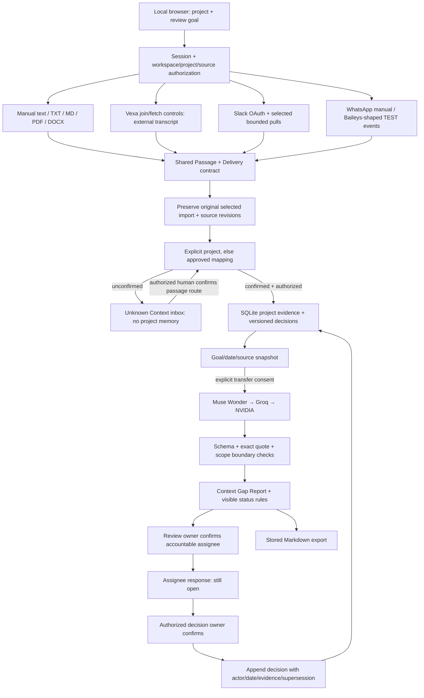

# ContextGuard architecture

This describes the fresh implementation in this repository, not the earlier application. Source adapters have no project-memory engines of their own.

## Actual code boundaries

- `app/contracts.py`: common source and model schemas. Strict booleans prevent the string `"false"` from acting as consent or a known answer.
- `app/storage.py`: one local SQLite records table, JSON entity values, a process lock and transaction per command. This is a fresh schema, not Synora's schema.
- `app/service.py`: accounts, source grants, project roles, deduplication/revisions, explicit/mapped/unknown routing and confirmed original-source segments.
- `app/adapters.py`: independent manual/Vexa/Slack/WhatsApp event readers. No message-send or transcription implementation.
- `app/providers.py`: bounded external calls and shared output validation. Primary endpoint/model are configured rather than guessed.
- `app/review.py`: authorized snapshot, prior-decision recall, citation checks, comparison-boundary checks, assignments, responses, confirmation and export.
- `app/api.py`: local-origin authentication, explicit operations, document snapshot reconciliation, OAuth state and protected token handling.
- `web/app.js`: source selection, inbox, team controls, exact passages and context-based answers. All source text is escaped; external links accept only HTTP(S).

## Boundaries that must stay visible

Unknown context cannot read or write project decisions. A model suggestion never changes a route. A source grant never grants access to an unrelated project's routed evidence. A response never implicitly resolves a finding. A source revision, absent document passage or deleted original invalidates dependent snapshots/segments. Earlier confirmed decisions remain inspectable even when their supporting source is no longer current.

Slack pulls are bounded and never claim full workspace coverage. A missing item from a complete selected pull becomes unavailable/uncertain, not a proven deletion; channel history does not invalidate thread-only replies. Actual deletion events create tombstone revisions. Vexa partial text remains partial, and empty speakers remain unattributed.

Baileys live pairing is deliberately disabled. Vexa/Slack REST/OAuth contracts are implemented and tested with controlled responses; real services and accounts remain unverified. Windows DPAPI token protection was denied in this execution environment, and OAuth correctly refused plaintext persistence.
