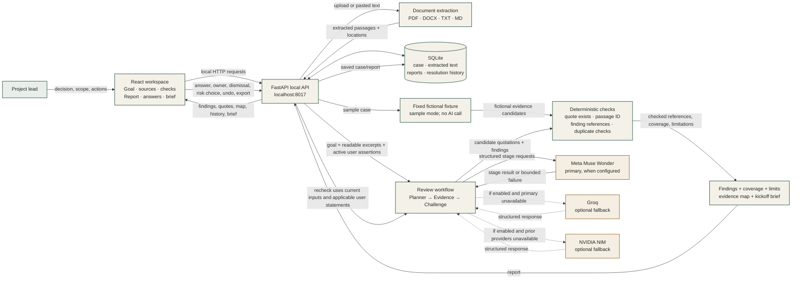

# ContextGuard: user journey and architecture

ContextGuard helps a project lead prepare for a kickoff by comparing a decision goal with the documents they already have. It surfaces questions and evidence gaps; it does not approve a project or prove that a document is true.

## What the user does

1. **Start** with a fictional sample to see the product, or create a review for their own decision.
2. **State the decision and scope.** For example: “Are we ready to start development?” and “First sprint only; deployment is out of scope.”
3. **Add evidence.** Upload PDF, DOCX, TXT, or Markdown, or paste notes. The user can preview extracted passages and remove sources. The app shows parsing limitations.
4. **Choose review checks.** Suggested checks can be excluded with a reason so the review stays within scope.
5. **Run the review.** The report shows prioritized findings, source quotations and locations, why each matters, uncertainty, and a question or next step.
6. **Inspect and respond.** Open the cited passage in context, view the evidence map, add a user answer or owner, leave the issue open, dismiss it with a reason, or record risk acceptance. These are user decisions, not independent verification.
7. **Recheck and prepare.** Re-run after a clarification, inspect or undo decision history, then edit/copy/download a Markdown kickoff brief. Nothing is sent to a teammate automatically.

## Architecture and data flow

The SVG beside this file is a standalone image of this flow. The Mermaid version below can also be rendered by Markdown viewers that support Mermaid.

## What is sent and stored

- **Sample:** uses fixed fictional sources and fixture findings. It makes no model request, but it exercises the report, citation-checking, SQLite, answer/history, map, and export paths.
- **Own review:** the goal, scope, readable extracted passages, review checks, and applicable user assertions are sent to configured AI providers for the review stages. Meta is preferred; configured and enabled Groq/NVIDIA fallbacks may be tried after bounded failures. Provider availability and semantic accuracy are not guaranteed.
- **Local storage:** extracted text, source metadata, reports, user decisions, and run metadata are saved in `data/contextguard.sqlite3`. Original uploaded file bytes are not retained. The browser stores only the active review ID.
- **Review checks:** application code verifies quotation presence in a referenced passage, IDs, references, conflict quote count, and duplicates. This validates the citation structure; it does not prove the quote is interpreted correctly or is truthful.
- **User choices:** answers, dismissal, and risk acceptance are saved as user statements/decisions. They do not rewrite source files or count as independent documentary evidence. The recheck only applies decisions bound to the current input fingerprint.

## Main implementation paths

| Responsibility | File |
|---|---|
| Workspace, screens, navigation, run state | `frontend/src/App.tsx` |
| Goal, scope, source upload/paste, checks | `frontend/src/components/Setup.tsx` |
| Findings, evidence map, answers, history, brief | `frontend/src/components/Report.tsx` |
| API routes, background run, local serving | `backend/app/main.py` |
| Sample/live orchestration, verification, export | `backend/app/workflow.py` |
| Provider selection, structured requests, retry/fallback | `backend/app/providers.py` |
| Parsing and passage locations | `backend/app/ingestion.py` |
| SQLite persistence and revisions | `backend/app/store.py` |

